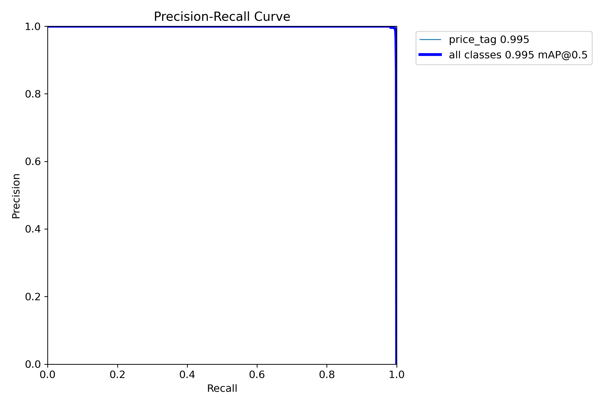
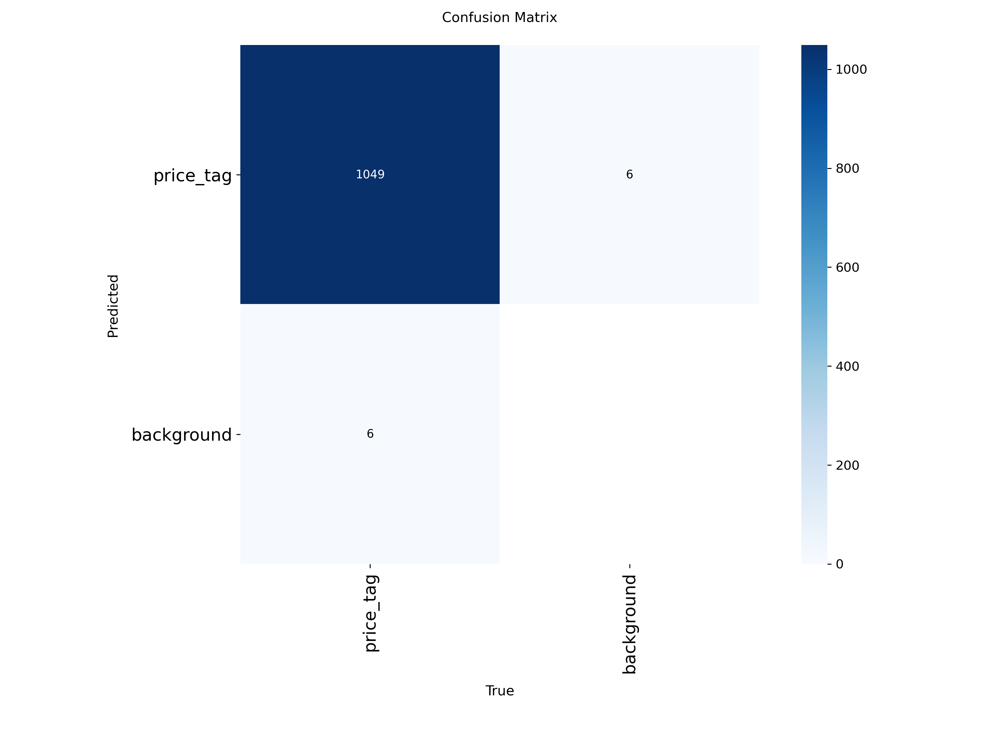

#  Price Tag Detection System


Система обнаружения ценников на видео с использованием компьютерного зрения. Разработана для автоматизации контроля полки в розничной торговле.

---

##  О проекте:

Система предназначена для автоматического обнаружения ценников на видео, снятых с робота-инспектора в торговом зале.

### Основные возможности

-  **Детекция ценников** на видео в реальном времени
-  **Трекинг** уникальных ценников между кадрами
-  **Веб-интерфейс** для загрузки видео и просмотра результатов
-  **Экспорт** в CSV с координатами и метриками
-  **Скачивание** размеченного видео с рамками
-  **Docker-контейнеризация** для лёгкого деплоя

---

##  Архитектура
##  Технологии
| Компонент | Технология | Функция |
|-----------|------------|---------|
| **Фронтенд** | HTML + CSS | Загрузка видео, отображение результатов |
| **API** | FastAPI | Обработка запросов, отдача CSV/видео |
| **Детекция** | YOLOv8 | Поиск ценников на кадре |
| **Трекинг** | Центроид | Объединение детекций в уникальные объекты |

---


## 📊 Результаты обучения

Модель обучена на 609 размеченных кадрах (487 train / 122 val) с использованием CVAT.


| Метрика | Значение |
|---------|----------|
| **mAP50** | **99.5%** |
| **mAP50-95** | **86.7%** |
| **Precision** | **99.5%** |
| **Recall** | **99.3%** |
| **F1-Score** | **99.5%** |

### Графики обучения

| График | Описание |
|--------|----------|
| [Precision-Recall Curve](docs/images/BoxPR_curve.png) | Кривая Precision-Recall |
| [Confusion Matrix](docs/images/confusion_matrix.png) | Матрица ошибок |
| [Training Logs](docs/results.csv) | Логи обучения |

---

##  Установка

### Вариант 1: через Docker 

```bash
# 1. Клонировать репозиторий
git clone https://github.com/sotnikovazhanna/price_tag_detection.git
cd price_tag_detection

# 2. Запустить через Docker Compose
docker-compose up -d

# 3. Открыть в браузере
http://localhost:8000
```
### Вариант 2: Локальная установка
```bash
# 1. Клонировать репозиторий
git clone https://github.com/sotnikovazhanna/price_tag_detection.git
cd price_tag_detection

# 2. Создать виртуальное окружение
conda create -n price_tag python=3.10 -y
conda activate price_tag

# 3. Установить зависимости
pip install -r requirements.txt

# 4. Запустить сервер
python -m app.main
# 5. Открыть в браузере
http://localhost:8000
```

## Структура проекта

```
price_tag_detection/
│
├── app/                                    # Основное веб-приложение
│   ├── static/
│   │   └── index.html                      # Веб-интерфейс для загрузки видео
│   ├── __init__.py
│   └── main.py                             # FastAPI сервер (основной код)
│
├── docs/                                   # Документация
│   ├── images/
│   │   ├── BoxPR_curve.png                 # Precision-Recall кривая (главный график)
│   │   ├── confusion_matrix.png            # Матрица ошибок (главный график)
│   │   ├── BoxP_curve.png                  # Precision-Confidence кривая
│   │   ├── BoxR_curve.png                  # Recall-Confidence кривая
│   │   ├── BoxF1_curve.png                 # F1-Confidence кривая
│   │   ├── confusion_matrix_normalized.png # Нормализованная матрица ошибок
│   │   └── screenshots/
│   │       ├── before_detection.png        # Кадр ДО детекции
│   │       ├── after_detection.png         # Кадр ПОСЛЕ детекции
│   │       └── result_interface.png        # Веб-интерфейс с результатами
│   └── results.csv                         # Полные логи обучения (50 эпох)
│
├── runs/                                   # Результаты обучения
│   └── train/
│       └── weights/
│           └── best.pt                     # Обученная модель YOLO (~6 MB)
│
├── training/                               # Скрипты для обучения
│   ├── __init__.py
│   ├── train_yolo.py                       # Скрипт обучения YOLO
│   └── evaluate_model.py                   # Скрипт оценки модели
│
├── scripts/                                # Вспомогательные скрипты
│   └── download_models.py                  # Скачивание предобученных моделей
│
├── data/                                   # Данные для обучения (пустая папка)
│   └── .gitkeep
│
├── .gitignore                              # Игнорируемые файлы для Git
├── requirements.txt                        # Зависимости Python
├── Dockerfile                              # Инструкция для сборки Docker образа
├── docker-compose.yml                      # Оркестрация Docker контейнеров
├── LICENSE                                 # Лицензия MIT
└── README.md                               # Документация проекта
```

---

## 🖼️ Пример работы

### До обработки

Исходный кадр с ценниками на полке.


### После обработки

Тот же кадр с детекцией ценников.


### Результат в интерфейсе

Веб-интерфейс после обработки видео.


## 📊 Результаты обучения

Модель обучена на 609 размеченных кадрах (487 train / 122 val).

### Основные метрики

| Метрика | Значение |
|---------|----------|
| **mAP50** | **99.5%** |
| **mAP50-95** | **86.7%** |
| **Precision** | **99.5%** |
| **Recall** | **99.3%** |

### Графики

#### Precision-Recall Curve (главный график)



> mAP50 = 99.5% — модель практически идеально находит ценники

#### Confusion Matrix (матрица ошибок)



> **1049** правильно обнаруженных ценников, **6** ложных срабатываний

#### Дополнительные графики

| График | Описание |
|--------|----------|
| [Precision-Confidence](docs/images/BoxP_curve.png) | Точность в зависимости от уверенности |
| [Recall-Confidence](docs/images/BoxR_curve.png) | Полнота в зависимости от уверенности |
| [F1-Confidence](docs/images/BoxF1_curve.png) | F1-мера в зависимости от уверенности |

### Динамика метрик по эпохам

| Эпоха | Precision | Recall | mAP50 | mAP50-95 | Время (с) |
|-------|-----------|--------|-------|----------|-----------|
| 1 | 0.968 | 0.633 | 0.923 | 0.541 | 1063 |
| 10 | 0.991 | 0.990 | 0.995 | 0.764 | 10078 |
| 20 | 0.992 | 0.989 | 0.995 | 0.804 | 17987 |
| 30 | 0.991 | 0.994 | 0.995 | 0.816 | 26056 |
| 40 | 0.995 | 0.992 | 0.995 | 0.854 | 34218 |
| **50** | **0.995** | **0.993** | **0.995** | **0.867** | **41603** |

