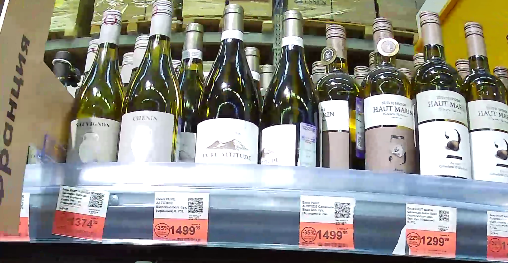
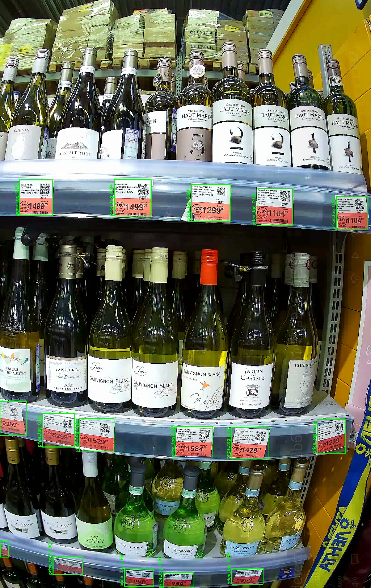
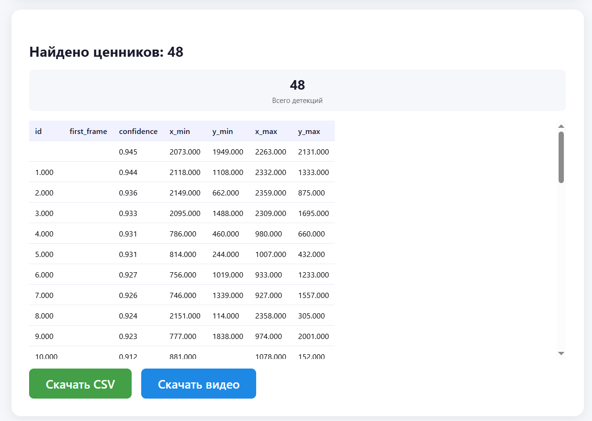

#  Price Tag Detection System


Система обнаружения ценников на видео с использованием компьютерного зрения. Разработана для автоматизации контроля полки в розничной торговле

---

##  О проекте:

Система предназначена для автоматического обнаружения ценников на видео, снятых с робота-инспектора в торговом зале

### Основные возможности

-  **Детекция ценников** на видео в реальном времени
-  **Трекинг** уникальных ценников между кадрами
-  **Веб-интерфейс** для загрузки видео и просмотра результатов
-  **Экспорт** в CSV с координатами и метриками
-  **Скачивание** размеченного видео с рамками
-  **Docker-контейнеризация** для лёгкого деплоя

---
##  Технический стек
| Компонент | Технология | Функция |
|-----------|------------|---------|
| **Фронтенд** | HTML + CSS | Загрузка видео, отображение результатов |
| **API** | FastAPI    | Обработка запросов, отдача CSV/видео |
| **Детекция** | YOLOv8n    | Поиск ценников на кадре |
| **Трекинг** | Центроид   | Объединение детекций в уникальные объекты |

---


##  Результаты обучения

Модель обучена на 609 размеченных кадрах (487 train / 122 val) с использованием CVAT


| Метрика | Значение | Интерпретация |
|---------|----------|----------------|
| **mAP50** | **99.5%** | Точность при пороге IoU ≥ 0.5 |
| **mAP50-95** | **86.7%** | Средняя точность по всем порогам IoU (0.5–0.95) |
| **Precision** | **99.5%** | Доля правильно найденных ценников среди всех найденных |
| **Recall** | **99.3%** | Доля найденных ценников среди всех реальных |
| **F1-Score** | **99.5%** | Гармоническое среднее между точностью и полнотой |

---
##  Установка

### Вариант 1: через Docker 

```bash
# 1. Клонировать репозиторий
git clone https://github.com/sotnikovazhanna/price_tag_detection.git
cd price_tag_detection

# 2. Запустить через Docker Compose
docker-compose up -d

# 3. Открыть в браузере
http://localhost:8000
```
### Вариант 2: Локальная установка
```bash
# 1. Клонировать репозиторий
git clone https://github.com/sotnikovazhanna/price_tag_detection.git
cd price_tag_detection

# 2. Создать виртуальное окружение
conda create -n price_tag python=3.10 -y
conda activate price_tag

# 3. Установить зависимости
pip install -r requirements.txt

# 4. Запустить сервер
python -m app.main

# 5. Открыть в браузере
http://localhost:8000
```

## Структура проекта

```
price_tag_detection/
│
├── app/                                    
│   ├── static/
│   │   ├── dashboard.html
│   │   └── index.html                      
│   ├── __init__.py
│   └── main.py                             
│
├── docs/                                   
│   ├── images/
│   │   ├── BoxPR_curve.png                 # Precision-Recall кривая 
│   │   ├── confusion_matrix.png            # Матрица ошибок 
│   │   ├── BoxP_curve.png                  # Precision-Confidence кривая
│   │   ├── BoxR_curve.png                  # Recall-Confidence кривая
│   │   ├── BoxF1_curve.png                 # F1-Confidence кривая
│   │   └── screenshots/
│   │       ├── before_detection.png        
│   │       ├── after_detection.png         
│   │       └── result_interface.png        
│   └── results.csv                         
│
├── runs/                                   # Результаты обучения
│   └── train/
│       └── weights/
│           └── best.pt                     # Обученная модель YOLO 
│
├── training/                               
│   ├── __init__.py
│   ├── train_yolo.py                       
│   └── evaluate_model.py                   
│
│
├── data/                                   
│   └── .gitkeep
│
├── .gitignore                              
├── requirements.txt                        
├── Dockerfile                              
├── docker-compose.yml                      
├── LICENSE                                 
└── README.md                               
```

---

## Пример работы

### До обработки

Исходный кадр с ценниками на полке



### После обработки

Тот же кадр с детекцией ценников



### Результат в интерфейсе

Веб-интерфейс после обработки видео




---
